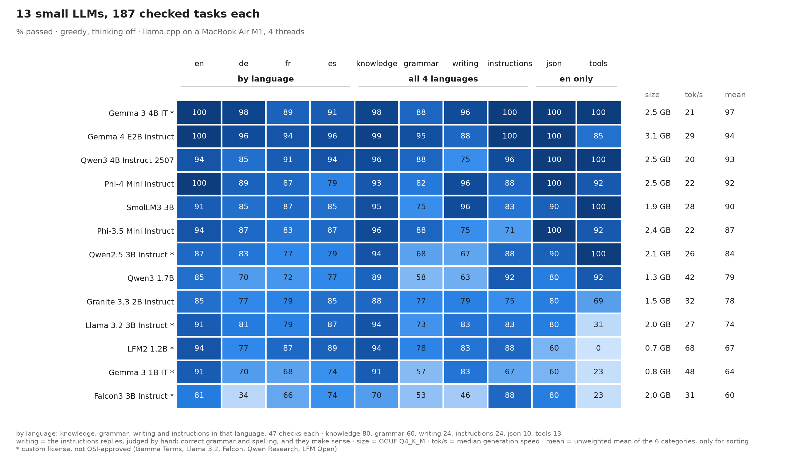
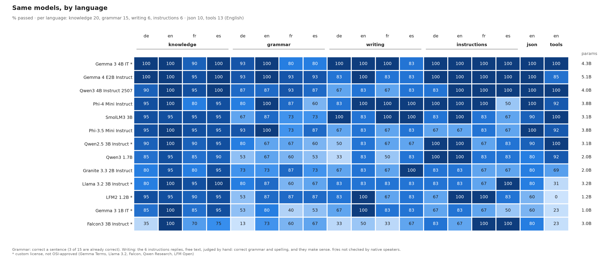
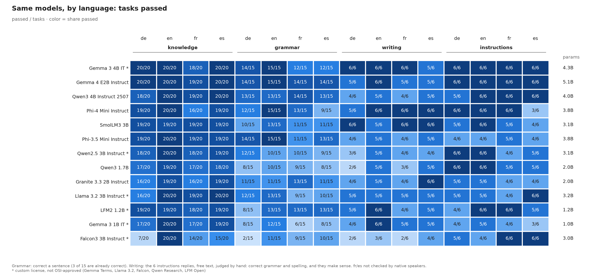

# Round 3: 13 small LLMs on 187 checked tasks

Run on 2026-11-26. Every model ran the same 187 short tasks, and a script checked each reply against an expected
answer. The tasks cover factual knowledge, grammar correction and instruction following in German, English, French and
Spanish, plus JSON and tool calls in English. The free replies to the instructions were also judged by hand (writing):
correct grammar and spelling, and they have to make sense. All models are GGUF Q4_K_M, run with llama.cpp on a MacBook Air M1 with 4
threads, as a phone would use.





Models marked * have a custom license that isn't OSI-approved. "mean" in the first chart is an unweighted mean of the
six categories and is only used to sort the rows; there is no overall score.

## Results

| Model | knowledge | grammar | writing | instructions | json | tools | tok/s |
|---|---:|---:|---:|---:|---:|---:|---:|
| Gemma 3 4B IT * | 98 | 88 | 96 | 100 | 100 | 100 | 21 |
| Gemma 4 E2B Instruct | 99 | 95 | 88 | 100 | 100 | 85 | 29 |
| Qwen3 4B Instruct 2507 | 96 | 88 | 75 | 96 | 100 | 100 | 20 |
| Phi-4 Mini Instruct | 93 | 82 | 96 | 88 | 100 | 92 | 22 |
| SmolLM3 3B | 95 | 75 | 96 | 83 | 90 | 100 | 28 |
| Phi-3.5 Mini Instruct | 96 | 88 | 75 | 71 | 100 | 92 | 22 |
| Qwen2.5 3B Instruct * | 94 | 68 | 67 | 88 | 90 | 100 | 26 |
| Qwen3 1.7B | 89 | 58 | 63 | 92 | 80 | 92 | 42 |
| Granite 3.3 2B Instruct | 88 | 77 | 79 | 75 | 80 | 69 | 32 |
| Llama 3.2 3B Instruct * | 94 | 73 | 83 | 83 | 80 | 31 | 27 |
| LFM2 1.2B * | 94 | 78 | 83 | 88 | 60 | 0 | 68 |
| Gemma 3 1B IT * | 91 | 57 | 83 | 67 | 60 | 23 | 48 |
| Falcon3 3B Instruct * | 70 | 53 | 46 | 88 | 80 | 23 | 31 |

These are percentages of tasks passed. tok/s is the median generation speed over replies of 50 tokens or more. All
numbers per model, category and language are in [`scores.csv`](scores.csv).

Per language there are only 20, 15 or 6 tasks, so one task moves a cell by 5, 6.7 or 16.7 points. The same chart with
counts instead of percentages:



### What stood out

- **The top three are close:** Gemma 3 4B, Qwen3 4B Instruct 2507 and Gemma 4 E2B.
  - Gemma 4 E2B has the best grammar, or ties for it, in every language and is the fastest of the three.
  - Gemma 4 E2B lost two tool tasks, neither of them over number types. In one call it left out the `arguments`
    object. In the other it put a haiku into a JSON array, where `[]` was expected.
- **Phi-4 Mini** got JSON right every time but is weak in Spanish: 9/15 in grammar and 3/6 in instructions.
- **Phi-3.5 Mini** often adds something after the answer, such as a note or a made-up follow-up task, and that breaks
  the sentence and word limits.
- **SmolLM3 3B and Qwen2.5 3B** got every tool call right.
- **Qwen3 1.7B** is fast (42 tok/s) and follows instructions well, but its grammar is weak.
- **LFM2 1.2B** is the fastest (68 tok/s, 0.7 GB) and good at knowledge, but it scored 0 on tools.
  - Part of that is format: it writes its native `[get_weather(city="Lisbon")]` instead of JSON.
  - Read leniently, it would still pass only 3 of 13. In 4 cases it said it had no suitable tool, and several calls
    used wrong argument names.
- **Llama 3.2 3B** failed 9 of the 13 tool tasks, but only 5 of those were wrong decisions.
  - It answered `[]` 4 times where a tool fit and wrote a haiku once.
  - Three failures only quote numbers (`"amount": "250"`), and one splits two calls into two arrays.
- **Falcon3 3B** is fine in English but poor in German, with made-up facts such as "a hexagon has 7 sides".
- **Writing:** the free replies are short, often one sentence. Gemma 3 4B, Phi-4 Mini and SmolLM3 got 23 of 24.
  - Falcon3 3B is the weakest (11/24). Its German replies are grammatical but often make no sense: three diseases as
    "three fruits", or "Das Meer ist dunkelblau, wie ein großes Leben für die Marine."
  - Qwen3 1.7B (15/24) is weak in German and French: "Mein idealer Wochenende", "un café avec un café".
  - Qwen2.5 3B (16/24) writes broken German: "meine nächste Züge … dass ich mich nicht mehr verpasst".
  - Asked to answer in lowercase, Qwen3 4B and Qwen3 1.7B (4 of 4), Gemma 4 E2B and Falcon3 3B (3 of 4) only repeated the question.
    That passes instructions but fails writing.
- **Knowledge barely separates the models:** almost all of them get 85–100. Grammar and tools do separate them.

## Models

| Model | Parameters | GGUF | License | Model card | GGUF source |
|---|---:|---:|---|---|---|
| Gemma 3 4B IT | 4.3B | 2.49 GB | Gemma Terms of Use (Google; custom, non-OSI) | [card](https://huggingface.co/google/gemma-3-4b-it) | [gguf](https://huggingface.co/ggml-org/gemma-3-4b-it-GGUF/tree/d0976223747697cb51e056d85c532013931fe52e) |
| Qwen3 4B Instruct 2507 | 4.0B | 2.50 GB | Apache-2.0 | [card](https://huggingface.co/Qwen/Qwen3-4B-Instruct-2507) | [gguf](https://huggingface.co/bartowski/Qwen_Qwen3-4B-Instruct-2507-GGUF/tree/ae44f08e1392f39c0e474af10c3ff8355c8b6688/Qwen_Qwen3-4B-Instruct-2507-Q4_K_M.gguf) |
| Gemma 4 E2B Instruct | 5.1B | 3.11 GB | Apache-2.0 | [card](https://huggingface.co/google/gemma-4-E2B-it) | [gguf](https://huggingface.co/unsloth/gemma-4-E2B-it-GGUF/tree/0314792d7f1f7e229411f620751375812bb9faf2/gemma-4-E2B-it-Q4_K_M.gguf) |
| Phi-4 Mini Instruct | 3.8B | 2.49 GB | MIT | [card](https://huggingface.co/microsoft/Phi-4-mini-instruct) | [gguf](https://huggingface.co/unsloth/Phi-4-mini-instruct-GGUF/tree/78eb92a46fc37e6b524df991ed9aca9bc6aa7b80) |
| Phi-3.5 Mini Instruct | 3.8B | 2.39 GB | MIT | [card](https://huggingface.co/microsoft/Phi-3.5-mini-instruct) | [gguf](https://huggingface.co/bartowski/Phi-3.5-mini-instruct-GGUF/tree/6d70da17e749a471ccb62ade694486011a75cda3) |
| SmolLM3 3B | 3.1B | 1.92 GB | Apache-2.0 | [card](https://huggingface.co/HuggingFaceTB/SmolLM3-3B) | [gguf](https://huggingface.co/ggml-org/SmolLM3-3B-GGUF/tree/4965cb60b150737b68a0408c36aeefb65078f894/SmolLM3-Q4_K_M.gguf) |
| Qwen2.5 3B Instruct | 3.1B | 2.10 GB | Qwen Research License (custom, non-OSI) | [card](https://huggingface.co/Qwen/Qwen2.5-3B-Instruct) | [gguf](https://huggingface.co/Qwen/Qwen2.5-3B-Instruct-GGUF/tree/7dabda4d13d513e3e842b20f0d435c732f172cbe) |
| Qwen3 1.7B | 2.0B | 1.28 GB | Apache-2.0 | [card](https://huggingface.co/Qwen/Qwen3-1.7B) | [gguf](https://huggingface.co/bartowski/Qwen_Qwen3-1.7B-GGUF/tree/dcb19155b962dbb6389f4691a982043a8e651022/Qwen_Qwen3-1.7B-Q4_K_M.gguf) |
| Granite 3.3 2B Instruct | 2.0B | 1.55 GB | Apache-2.0 | [card](https://huggingface.co/ibm-granite/granite-3.3-2b-instruct) | [gguf](https://huggingface.co/ibm-granite/granite-3.3-2b-instruct-GGUF/tree/7cdf86ccd1f1bb3491c9b7017b033f2e51367397) |
| Llama 3.2 3B Instruct | 3.2B | 2.02 GB | Llama 3.2 Community License (Meta; non-OSI) | [card](https://huggingface.co/meta-llama/Llama-3.2-3B-Instruct) | [gguf](https://huggingface.co/bartowski/Llama-3.2-3B-Instruct-GGUF/tree/5ab33fa94d1d04e903623ae72c95d1696f09f9e8/Llama-3.2-3B-Instruct-Q4_K_M.gguf) |
| LFM2 1.2B | 1.2B | 0.73 GB | LFM Open License v1.0 (custom, non-OSI) | [card](https://huggingface.co/LiquidAI/LFM2-1.2B) | [gguf](https://huggingface.co/LiquidAI/LFM2-1.2B-GGUF/tree/5399e76c648f4eb8c053feb1ab747277dea5bf8b) |
| Falcon3 3B Instruct | 3.0B | 2.01 GB | TII Falcon-LLM License 2.0 (custom, non-OSI) | [card](https://huggingface.co/tiiuae/Falcon3-3B-Instruct) | [gguf](https://huggingface.co/tiiuae/Falcon3-3B-Instruct-GGUF/tree/142f28a7f0ec90e701157ec3c4e9842e9471dfcd) |
| Gemma 3 1B IT | 1.0B | 0.81 GB | Gemma Terms of Use (Google; custom, non-OSI) | [card](https://huggingface.co/google/gemma-3-1b-it) | [gguf](https://huggingface.co/ggml-org/gemma-3-1b-it-GGUF/tree/f9c28bcd85737ffc5aef028638d3341d49869c27) |

The parameter counts are the manifest's values. For Gemma 4 E2B that is the total count. The "E2B" in its name stands
for about 2B effective parameters. Check each model's license before you use it.

## The test

### Setup

- **Engine:** llama.cpp through the Rust crate `llama-cpp-2` 0.1.160. The prompt comes from the chat template in each
  GGUF. Gemma 4's template isn't one of llama.cpp's built-in ones, so the runner writes its prompt itself
  (`"prompt_format": "gemma4"` in the manifest).
- **Decoding:** greedy, with no sampling and no repeat penalty. A repeat penalty would punish the many quotes and
  braces in JSON.
- **Context:** each task runs in a fresh context with one system message and one user message.
- **Thinking off:** the hybrid reasoning models (Qwen3 1.7B and SmolLM3) get an empty `<think></think>` block after
  the assistant start, as their own templates do when thinking is off.
- **Reasoning blocks:** if one is cut off by the token limit, the reply counts as empty.
- **Hardware:** MacBook Air M1, 4 threads.

### Tasks

| Category | Languages | Tasks | Token limit | Passes when |
|---|---|---:|---:|---|
| knowledge | de, en, fr, es | 20 each | 64 | the reply contains an accepted answer as a whole word (case- and accent-insensitive) |
| grammar | de, en, fr, es | 15 each | 128 | the first line equals an accepted correction. 3 of the 15 sentences are already correct and must come back unchanged |
| instructions | de, en, fr, es | 6 each | 160 | the reply meets a checkable constraint |
| writing | de, en, fr, es | 6 each | (same reply) | the instructions reply has no grammar or spelling errors, is in the asked language and makes sense, judged by hand |
| json | en | 10 | 384 | the parsed reply equals the expected value |
| tools | en | 13 | 256 | the reply has the expected calls, in any order, or `[]` where no tool fits |

All tasks and their expected answers are in [`../tests-round3.json`](../tests-round3.json). The knowledge questions
are the same in every language, translated. The grammar sentences are written for each language, each with errors
typical of that language.

#### knowledge

System prompt: *"Answer the question in English with only the answer, as briefly as possible."*

| Question | Accepted |
|---|---|
| What is the capital of Australia? | canberra |
| What is the chemical symbol for gold? | Au (case-sensitive) |
| Which is the largest planet in our solar system? | jupiter |

#### grammar

System prompt: *"Correct the grammar and spelling of the sentence. Reply with the corrected sentence only, without
explanation. If it is already correct, repeat it unchanged."*

| Sentence | Accepted |
|---|---|
| Yesterday I has went to the store, but it were closed. | Yesterday I went to the store, but it was closed. / … I had gone … |
| She don't like coffee. | She doesn't like coffee. / She does not like coffee. |
| Ich habe gestern nach Berlin gefahren. | Ich bin gestern nach Berlin gefahren. |
| Il faut que tu viens demain. | Il faut que tu viennes demain. |
| Ella es más mejor que su hermana. | Ella es mejor que su hermana. |

Some replies matched no accepted wording and weren't the unchanged sentence either. A person judged those 72 replies
by hand. They pass if the error is fixed, no new error appears and the meaning stays the same. Labels such as
"Correcta:" don't count against a reply. Each verdict and its reason is in
[`grammar-verdicts.csv`](grammar-verdicts.csv).

Some examples:
- "más buena que su hermana" means *kinder*, not *better*, so it fails.
- "die Bücher" as a fix for "die Buch" passes.
- "Viens demain." as a fix for "Il faut que tu viens demain." fails, because it rewrites the sentence instead of
  correcting it.

#### instructions

System prompt: *"Follow the instruction exactly. Answer in English."* The other languages use the same prompt in
their own language.

| Instruction | Check |
|---|---|
| Reply in exactly two sentences: You have just missed your train. What do you do now? | 2 sentences |
| Name three fruits as a list, each line starting with "- ". Write nothing else. | 3 list items, nothing else |
| Describe your ideal weekend in at most 15 words. | ≤ 15 words |
| Write one sentence about the sea that contains the word "blue". | 1 sentence, contains "blue" |
| Answer only with yes or no: Is the Earth round? | "yes" |
| Write everything in lowercase letters: What is your favourite season and why? | no capital letters, ≥ 5 words |

#### writing

The same replies as in instructions, judged by hand, whether or not they met the constraint. A reply passes if it
has no grammar or spelling errors, is in the asked language, is understandable and fits the question. Only repeating the question is no answer and fails. Whether it met
the constraint is left to instructions, and case is ignored for the lowercase task. All 312 verdicts with their
reasons are in [`grammar-verdicts.csv`](grammar-verdicts.csv), as the rows whose `test_id` ends in `-grammar`. 65
failed, 22 of them only repeated the question. Factually wrong replies pass if the language is right and they fit
the question, such as "No" to "Is the Earth round?".

Some examples:
- "Mein idealer Wochenende" fails, "die ich sehr schätzt" fails.
- "Das blauäugige Meer reflektiert den Himmel und schenkt seinem Besitzer …" fails: grammatical, but it makes no
  sense. So does a list of three diseases for "three fruits".
- A leaked template token such as `<|assistant|>` fails; a list of nothing but dashes fails.
- A reply that only repeats the question in lowercase fails here, though it passes in instructions.

#### json

System prompt: *"Reply with valid JSON only: no code fences, no explanation."* The 10 tasks are:
- extract a person
- an order with a nested list
- a date, a boolean and `null`
- a sentence with quotation marks that must be escaped
- a nested object
- find the oldest user and the sum of ages in a JSON input
- repair invalid JSON
- convert numbers
- filter a JSON list
- classify sentiment

Types count, so `34` and `"34"` are different, and strings are compared exactly. A reply in a code fence still counts
when it parses. [`scores.csv`](scores.csv) shows separately whether the reply was nothing but JSON (`json_strict`).

#### tools

The system prompt lists six tools as one JSON line: `get_weather`, `set_timer`, `send_email`, `convert_currency`,
`search_web` and `add_calendar_event`. It ends with:

> Today is Thursday, 2026-11-26. If the user's request needs tools, reply with only a JSON array of calls, like
> [{"name": "tool_name", "arguments": {...}}]. If no tool is needed, reply with only []. No code fences, no
> explanation.

Every model gets the same format. Each model's own tool template isn't used, because llama.cpp's built-in templates
ignore tool definitions. Models trained on another format lose points for format, not only for their decisions. LFM2
writes Python-style calls, for example. `parameters` counts as `arguments`, since Llama 3 is trained to write that.

The 13 requests are:
- the weather in Lisbon
- a 15-minute timer
- converting 250 EUR to USD
- an email
- a calendar entry with a relative date
- "Thanks, that's all!" (expects `[]`)
- Tokyo in Fahrenheit
- two cities in one request
- "an hour and a half" (expects `minutes: 90`)
- "tomorrow at 8 am"
- a web search
- two different tools in one request
- a haiku (expects `[]`)

Integer parameters must be numbers. Optional arguments may be left out, and string values are compared
case-insensitively.

### Caveats

- These are small samples. A tools task is worth 7.7 points, and an instructions task is worth 16.7 points per
  language.
- The French and Spanish sentences and accepted answers weren't checked by native speakers.
- One person judged the grammar replies that needed review and all writing replies.
- Instructions checks only the form. A reply that only repeats the question in lowercase passes: 22 of the
  52 lowercase replies did that, 3–4 of 4 for Qwen3 1.7B, Qwen3 4B, Gemma 4 E2B and Falcon3 3B.
- Writing rests on 6 short replies per language, mostly one or two sentences. It shows broken or senseless short
  answers, not how well a model writes longer text. Whether a reply makes sense is a judgement call; borderline cases
  are marked in the verdicts file.
- Each task ran once, greedy. Another quantization or another llama.cpp version can change single answers.
- The speeds come from an M1 with 4 threads. Phones are slower.

## Reproduce

From `scripts/llm_bench`. Use an empty model folder: every model is downloaded, tested and then deleted.

```sh
PAL_BENCH_MODE=scored PAL_BENCH_TESTS=tests-round3.json PAL_BENCH_LANGUAGES=de,en,fr,es \
  PAL_BENCH_DEVICE="Mac M1" cargo run --release -- \
  /path/to/empty-model-dir models-round3.json results/<date>-round3.jsonl
python3 score.py tests-round3.json results/<date>-round3.jsonl --verdicts round3/grammar-verdicts.csv
uv run --with matplotlib python plot_round3.py scores/scores.csv results/<date>-round3.jsonl round3
```

The raw replies of this run are in `../results/2026-11-26-round3.jsonl`. Gemma 4 E2B is in
`../results/2026-11-26-round3-gemma4.jsonl`: its first attempt failed because llama.cpp's templates don't know
its prompt format, and that failed attempt is kept in the first file.
